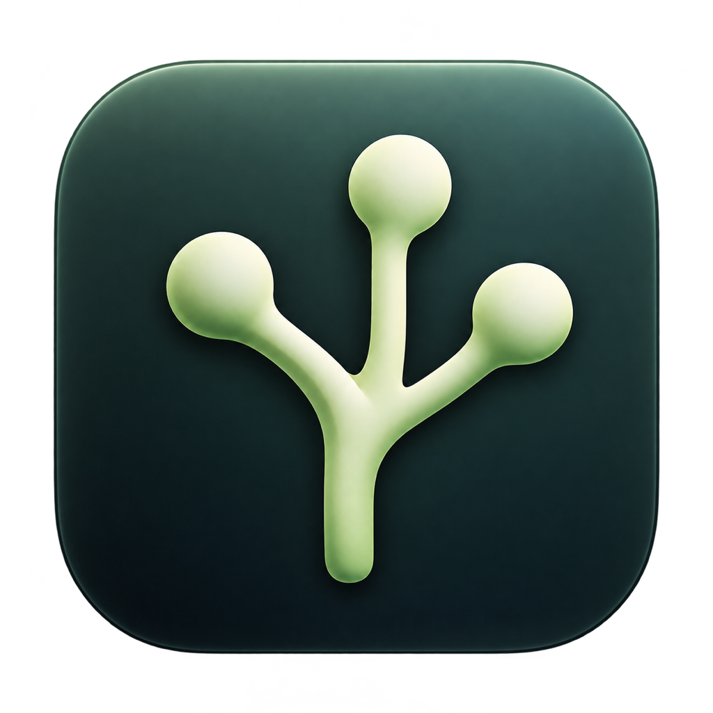
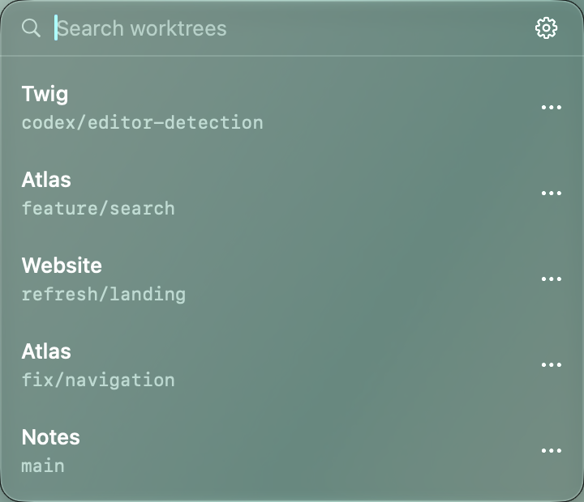

<p align="center">
  
</p>

<h1 align="center">Twig</h1>
<p align="center"><strong>Your worktrees. The right editor. One click.</strong></p>
<p align="center">A small native macOS menu-bar app for getting back to your Codex projects.</p>
<p align="center">
  <a href="https://github.com/lkuczborski/Twig/releases/latest">Download</a> ·
  <a href="#how-it-works">How it works</a> ·
  <a href="docs/ROADMAP.md">Roadmap</a> ·
  <a href="LICENSE">MIT License</a>
</p>

<p align="center">
  
  <br><sub>Native SwiftUI, with Liquid Glass on macOS 26. Demonstration repositories shown.</sub>
</p>

## Pick up where you left off

Codex worktrees are useful until you have to hunt through folders to find the right checkout. Twig puts your recent worktrees and their current Git branches in the menu bar, figures out which editor fits each project, and opens the right target when you click.

- **Open the project, not just its folder.** Xcode workspaces, IDE project files, and nested project targets are detected automatically.
- **Keep the choice yours.** Override an editor or project target for any individual worktree. Every suggestion has an explanation.
- **Find it quickly.** Search project names, branches, paths, or editors. Press Return to open the first match.
- **Get to Finder.** Option-click a row to open its folder. More actions let you reveal its enclosing folder or copy its path.
- **Stay current without polling.** Filesystem events invalidate cached results. Closed menus collect pending changes without rescanning.
- **Keep it local.** No account, analytics, cloud service, or project-code execution. Twig does not read Codex conversations or credentials.

## Install

1. [Download Twig v0.1](https://github.com/lkuczborski/Twig/releases/download/v0.1/Twig-v0.1-macos-universal.zip).
2. Unzip it and move **Twig.app** to **Applications**.
3. Open Twig and look for the branch symbol in your menu bar.

**macOS 14 or later · Apple Silicon and Intel · Developer ID signed and notarized**

Twig lives in the menu bar and has no Dock icon. Liquid Glass is available on macOS 26; earlier versions use a native translucent material. [SHA-256 checksum](https://github.com/lkuczborski/Twig/releases/download/v0.1/Twig-v0.1-macos-universal.zip.sha256).

## How it works

Twig discovers existing local checkouts under your Codex home, reads Git metadata for their branch names, and inspects project structure and small configuration snippets to suggest an installed editor. It opens URLs through macOS rather than running project scripts or shell launch commands.

| Project evidence | Examples of suggested editors |
| --- | --- |
| Xcode projects, workspaces, Swift packages | Xcode |
| VS Code workspaces and editor metadata | Visual Studio Code, Cursor, Windsurf, Zed |
| JetBrains metadata and language manifests | IntelliJ IDEA, PyCharm, WebStorm, GoLand, CLion, RustRover, PhpStorm, RubyMine |
| Android, Flutter, .NET, game projects | Android Studio, Rider |
| R projects and other source folders | RStudio or an installed general editor |

A saved worktree choice takes priority over detection. If no suitable installed editor is found, Twig falls back to your chosen editor or Finder. Mixed repositories expose their detected targets in **Project & detection details**.

The default location is `~/.codex/worktrees`, or `$CODEX_HOME/worktrees` when supplied at launch. Choose another Codex home in Settings. Only existing local worktrees appear; archived, deleted, and remote worktrees are not reconstructed. “Recent” means observed filesystem/Git activity or the last successful open through Twig, rather than chat activity.

| Shortcut | Action |
| --- | --- |
| Return | Open the first search result |
| Option-click | Open the worktree folder in Finder |
| ⌘R | Refresh |
| ⌘, | Settings |
| Escape | Dismiss Twig |
| ⌘Q | Quit Twig |

Keyboard shortcuts apply while Twig is focused. Settings and Quit are also in the gear menu.

## Build from source

Requires a Mac and Xcode 26 or newer, or a compatible Swift 6 toolchain with a macOS 26 SDK. No third-party package dependencies.

```sh
git clone https://github.com/lkuczborski/Twig.git
cd Twig
./script/build_and_run.sh
./script/test.sh
```

The build script stages a local development app in `dist/Twig.app`. A separate [release workflow](docs/RELEASING.md) builds both architectures, signs, notarizes, staples, and checks the extracted archive before publication.

Read the [development guide](docs/DEVELOPMENT.md), [architecture](docs/ARCHITECTURE.md), and [verification notes](docs/VERIFICATION.md). The [roadmap](docs/ROADMAP.md) includes keyboard navigation, launch at login, pins, repository grouping, and more editor actions. Ideas and reproducible bug reports are welcome in [Issues](https://github.com/lkuczborski/Twig/issues).

## License

[MIT](LICENSE) · Copyright © 2026 Łukasz Kuczborski.
