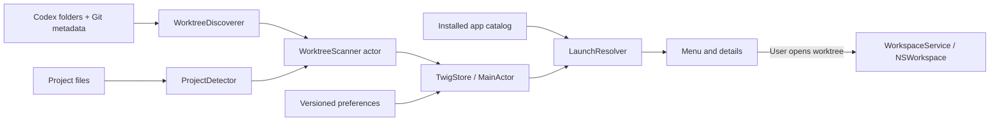

# Twig architecture

Twig is a native macOS 14+ menu bar utility built with Swift 6, SwiftUI, and a narrow AppKit launch boundary. The MVP has no third-party package dependencies or network service. Discovery suggests a compatible editor from local evidence; it cannot establish which editor a person actually prefers without a saved choice.

## Targets and responsibilities

| Target / component | Responsibility |
| --- | --- |
| `TwigCore/Discovery` | Discover existing Codex checkouts, parse live Git metadata, estimate recent activity, cache project inference in a scanner actor. |
| `TwigSync` | FSEvents lifecycle, directory-event routing, and pending refresh state independent of views. |
| `TwigCore/Detection` | Scan project structure and bounded snippets; return ranked editor/target candidates with reasons. |
| `TwigCore/Launching` | Identify installed app bundles and resolve launch policy without launching anything. |
| `TwigCore/Preferences` | Versioned preferences, canonical worktree keys, atomic JSON persistence. |
| `Twig` | Menu bar, search, worktree actions, detection details, settings, observable state, and `NSWorkspace` integration. |
| `TwigInspect` | Read-only JSON diagnostics using the same core discovery, detection, and launch resolution. Never opens an editor or saves settings. |
| `TwigCoreTests` | Swift Testing fixtures for discovery, detection, caching, installed apps, policy, and persistence. |
| `TwigSyncTests` | Refresh-state/routing fixtures and real FSEvents integration tests. |

## Discovery contract

The GUI chooses Codex home from its saved setting, then `CODEX_HOME`, then `~/.codex`. `TwigInspect --codex-home PATH` takes precedence over those defaults.

`WorktreeDiscoverer.discover(in:)` returns `WorktreeDiscoveryResult(worktrees:warnings:)`. The supported layout is `<codexHome>/worktrees/<identifier>/<repository>`, with a compatibility path for checkouts directly under `worktrees/<identifier>`. This is a local filesystem convention, not a public Codex API. Other layouts and arbitrary Git repositories are not automatically searched.

A `Worktree` carries its canonical folder path as a stable ID, repository folder name, branch, optional HEAD revision, activity date, and resolved Git administrative/common directories for watching. Branch changes do not change the ID. Discovery accepts Git pointer files or `.git` directories, reads the current `HEAD`, follows safe symbolic refs, and checks loose or packed refs. Detached HEAD is represented by a nil branch; unborn branches may have a name but no revision. Reciprocal Git pointers, when present, must refer back to the checkout. Invalid or missing metadata produces a warning instead of stopping the whole scan.

The scanner does not invoke Git. Symlinked checkout groups, checkouts, project children, and Git reference paths are excluded. Git's explicit `gitdir` and `commondir` pointers may refer outside the checkout, as required by linked worktrees. Small metadata reads are capped at 16 KiB; `packed-refs` has an 8 MiB cap. Only existing checkouts appear; archived or deleted worktrees are not reconstructed.

### What “recent” means

`lastActivity` is the latest observed modification time among:

- The checkout root and up to 2,000 visible project entries through three levels, excluding dependency/build directories and symlinks.
- `.git`, per-worktree `HEAD`, `index`, `logs/HEAD`, and `codex-thread.json`.
- The current loose branch ref, when it exists.

Only modification times are read from `logs/HEAD` and `codex-thread.json`. The UI orders worktrees by the later of this activity date and the last successful open through Twig, with canonical path as a stable tie-breaker. This is not Codex conversation recency. Deep source edits beyond the scan bounds may not affect order until Git metadata changes. File timestamps can also reflect checkout or build activity.

## Project detection and launch policy

`ProjectDetector.detect(at:)` returns a `ProjectDetection` containing candidates, the examined file count, and a truncation flag. A `ProjectCandidate` holds an `IDEID`, launch target, project kind, evidence reason, and relative confidence score. Scores rank evidence; they are not probabilities about a user's preference.

Detection visits shallow directories first, through four levels and at most 6,000 entries. It skips symlinks, Git internals, common dependency/build directories, and the contents of project/app bundles. Content inspection has a 1 MiB budget, with at most 64 KiB per file plus a byte to detect truncation. Reads focus on selected configuration formats and ambiguous Objective-C `.m` files. No project script, package manager, build tool, or executable is run.

Rules cover explicit editor metadata, Xcode workspaces/projects and Swift packages, JVM/Android, JavaScript/TypeScript, Python, Rust, Go, C/C++, .NET, PHP, Ruby, R, Flutter/Dart, Unity/Unreal, and additional source-language hints. Editor metadata and manifests rank above source extensions; generic folder editors rank last. A monorepo can yield multiple launch targets, which remain visible in the details window.

`LaunchResolver.resolve(...)` is a pure decision function. Its precedence is:

1. The saved worktree override, including its chosen target when valid.
2. The highest-ranked project-evidence candidate whose IDE is installed.
3. The configured fallback editor, if installed.
4. An installed generic folder editor.
5. Finder.

An unavailable explicit override becomes `.missingApp`; Twig does not silently replace that choice. Targets are normalized and constrained to the worktree, including after symlink resolution. `WorkspaceService` checks existence again immediately before opening and passes URLs to `NSWorkspace`, without shell interpolation. Finder opening, revealing the enclosing folder, and copying the folder path are separate actions.

Installed applications are identified by known bundle identifiers through Launch Services, supplemented by a bounded scan of `/Applications` and `~/Applications`. That scan examines at most three levels and 6,000 entries across both roots, reads at most 256 KiB from an app's `Info.plist`, and does not descend into app bundles or symlinked directories.

## State, persistence, and concurrency

The menu uses one native SwiftUI `glassEffect(.regular)` surface on macOS 26+, with matching rounded clipping. `MenuBarPanelController` presents it through an `NSHostingView` in a transparent, nonactivating `NSPanel`. This avoids `MenuBarExtra`'s additional frosted window backdrop, which caused the glass to sample already-blurred content instead of the desktop directly. There is no AppKit glass wrapper, custom blur, tint, or opacity approximation. Earlier macOS versions use one SwiftUI ultra-thin material in the same transparent panel.

AppKit owns application startup, the status item, positioning, focus, Escape/outside-click dismissal, and reusable Settings/detail windows; SwiftUI owns all view content, controls, glass, and observable model bindings. Presentation actions are explicit callbacks, so the hosted views do not rely on scene actions from an absent SwiftUI scene. Native edit-menu commands preserve text editing. Event monitors exist only while the panel is open and are removed on dismissal. Native action-menu tracking preserves the parent panel, and clicks on Twig's status button are left to its toggle action rather than the outside-click monitor. No refresh polling or presentation timer is added.

Search keeps the scroll container alive and sizes its viewport from the unfiltered catalog, so matching and empty states do not resize the hosting panel or move the search header. SwiftUI geometry changes resize and re-anchor the panel when its catalog or banners change; presentation restores search focus through `FocusState`.

Worktree button actions capture modifier flags synchronously. Option-click opens the checkout folder through the existing workspace service; an ordinary click resolves and opens its IDE. The same Finder action remains available in the row menu.

`TwigStore` owns observable UI state on `MainActor`. The `WorktreeScanner` actor serializes discovery and detection off the main actor. It caches project inference by canonical checkout ID, rechecks only invalidated or new checkouts, and prunes removed entries. Git metadata and activity are refreshed on a relevant change; branch-only changes reuse project inference. Manual full refresh and changing Codex home discard inference. Results from a Codex home that changed during scanning are discarded.

### Event-driven syncing

There is no repeating refresh timer. A utility-queue FSEvents stream watches the worktree catalog, each linked checkout's external Git administrative/common directories, and application directories. Missing roots are watched through their closest existing ancestor until creation. Directory notifications are batched by macOS with a one-second latency; a single 250 ms debounce coalesces a delivered burst while content is visible. Common build/dependency events and Git object churn are ignored. A checkout event invalidates that project's inference; an external HEAD/ref event refreshes metadata; catalog changes trigger discovery; app installation/removal invalidates the application catalog.

Changes merge into pending state while hidden, without scheduling scans. An unchanged menu reopening does no work. Opening after a relevant change consumes pending work; clicking a row waits for any active refresh before resolving its current target. A small AppKit window observer measures actual visibility because SwiftUI can retain dismissed menu content. A visible details window also participates. Settings alone does not cause worktree scanning.

Dropped events and moved roots trigger conservative full invalidation and subscription rebuilding. The event ID captured before a scan is used when expanding/replacing subscriptions, so events during the scan are replayed. Sleep stops the stream; wake restarts it and marks data stale, with scanning deferred if hidden. A failed watcher falls back to refreshing on presentation and exposes manual ⌘R. FSEvents are advisory, so manual full refresh remains available.

Launch Services lookup runs on the main actor; supplementary application-directory scanning runs in a detached utility task. The app catalog is cached until a relevant event or explicit refresh. The small preferences file remains synchronous and owned by the main actor.

Preferences are stored at `~/Library/Application Support/Twig/preferences.json`, with schema version 1 and atomic writes. They contain Codex home, fallback editor, per-worktree overrides, and last-open timestamps. Overrides use canonical checkout paths, not repository names or branch names, so sibling worktrees keep independent choices. Selecting a project in details can save its target as well as its IDE. “Automatic” removes that override.

Unknown schema versions or unreadable preferences block ordinary saves to preserve existing data. The GUI offers explicit backup-and-reset recovery. `PreferencesPersisting` is the existing injection boundary for alternative storage; `TwigStore` currently uses `FilePreferencesStore` directly.

## Privacy and extension boundaries

The app reads local project structure, selected small source/configuration snippets, Git metadata, installed app metadata, and its own preferences. It does not read Codex conversations, session logs, credentials, or Git commit messages. Discovery and inspection do not modify worktrees. Opening an IDE is an explicit user action; the receiving IDE controls its own project-loading behavior.

Extend the current layers rather than adding project rules to views:

- Add an editor's stable identifier and bundle IDs to the catalog, then add evidence rules and fixture coverage. Keep unavailable-editor behavior in launch policy.
- Add project formats in the detector, preserving bounded reads, reasons, deterministic ranking, and target containment.
- Add future actions through an action model and the platform service boundary; keep scanning side-effect free.
- Introduce a discovery-source protocol when supporting additional roots or non-Codex worktrees. The current discoverer is intentionally concrete.
- Extend event routing or scan caching while preserving hidden-state coalescing, a manual full refresh, and the same core result types.
- Migrate preference schema explicitly before introducing repository-wide rules or custom applications.

Tests build isolated temporary directory fixtures, so core behavior and event routing can be checked without installed IDEs, an active Codex account, a GUI session, or executing Git. Real watcher tests require access to the macOS FSEvents service; GUI launching and window visibility still require smoke testing. `TwigInspect` exposes the actual local candidates and decisions for that verification; its JSON includes paths and branch names, so review it before sharing.
